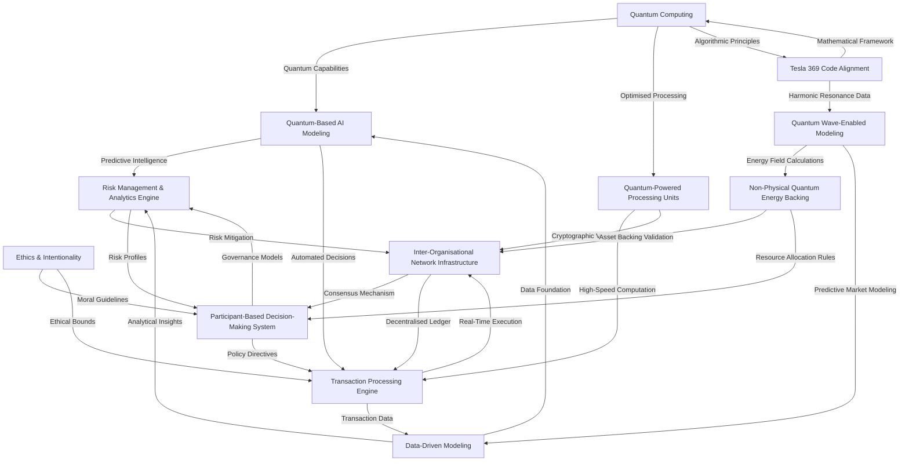

# CURRICULUM VITAE: SOVEREIGN SYSTEMS ARCHITECT

**Contact:** [sovereignties3@gmail.com](mailto:sovereignties3@gmail.com)  
**Role Target:** Chief Sovereign Systems Architect | Principal Distributed FinTech Engineer | Head of Autonomous Infrastructure  
**Core Creed:** *"Legacy IT maintains vendor scaffolding; sovereign engineering commands the bare-metal runtime."*

---

## 1. EXECUTIVE SUMMARY & ARCHITECTURAL PROFILE

Battle-hardened **Principal Sovereign Systems Architect** and **Quantitative Infrastructure Engineer** with deep boots-on-the-ground mastery over adversarial runtime security, hardware-attested agentic execution, zero-knowledge financial settlement, and tier-1 multi-bank programmatic orchestration. 

Author of the definitive 12-session curriculum **AIBANKING 9999** (*"Why Your IT Department Has No Training or Education (What I Mastered)"*) and creator of the **Kronos Apex Financial Operating System**. Pioneer of post-corporate financial sovereignty, specializing in eliminating compliance theater, breaking legacy vendor dependency, and deploying mathematically infallible, self-healing, multi-cloud financial fabrics capable of resisting both state-level adversaries and sub-system failures.

---

## 2. CORE CAPABILITIES & TECHNICAL ARSENAL

### Cryptographic Identity & Tier-1 Banking Rails
- **FAPI 1.0 Advanced / Zero-Trust mTLS**: Implementation of strict mutual TLS pipelines with RFC 8705 certificate-bound access tokens (`cnf.x5t#S256`), Private Key JWT (`private_key_jwt`) signing via ECDSA P-256 / Ed25519, and ephemeral nonces.
- **Multi-Bank API Orchestration**: Native programmatic ingestion, state reconciliation, and treasury sweeps across tier-1 institutional rails (JPMorgan Chase, Citi, Bank of America, SVB).
- **ISO 20022 Financial Messaging**: End-to-end typed construction, canonical XML schema validation, and XML-DSig cryptographic signing for `pacs.008.001.10` (credit transfers), `pacs.002` (payment status), `pain.001` (payment initiation), and `camt.053` (bank-to-customer statement) wire formats.
- **Automated Liquidity Sweeps**: Deterministic overnight cash concentration and repo sweep algorithms with UUIDv4 cryptographic idempotency hashes.

### Zero-Knowledge Proofs & Confidential Ledger Settlement
- **Circom & Groth16 Solvency Engines**: Development of zero-knowledge arithmetic constraint circuits to mathematically verify institutional asset-liability solvency ($A \ge L$) without disclosing individual account balances, counterparty identities, or asset allocations.
- **Poseidon Cryptographic Hashing**: In-circuit ultra-efficient algebraic hashing optimized for prime-field SNARK verification.
- **Cryptographic Auditability**: Zero-leakage verification bridges enabling external regulatory proof generation without balance sheet data exposure.

### Adversarial Runtime Security & Kernel Hardening
- **Linux Namespace & Capability Stripping**: Automated container lockdown dropping all 38 POSIX Linux capabilities, isolating PID/MNT/NET/IPC namespaces via `/proc/self/ns`, enforcing read-only root filesystems, and unprivileged user namespace remapping.
- **eBPF Kernel Telemetry**: Low-overhead kernel tracepoint probes (`sys_enter_connect`, `sys_enter_execve`, `sys_enter_bind`) delivering non-bypassable syscall auditing directly at the kernel boundary.
- **Packet-Level Fraud Forensics**: Live Shannon entropy analysis on outbound TLS payloads to detect covert exfiltration channels, C2 beacons, and side-channel leakages in sub-millisecond timeframes.

### Autonomous Agent Architecture & Deterministic Ledgers
- **Model Context Protocol (MCP) Financial Toolsets**: Secure, deterministic JSON-RPC 2.0 tool-calling fabrics for autonomous AI financial agents with runtime Zod parameter boundary enforcement.
- **Pre-Execution Invariant Guardrails**: Hard assertion checks preventing execution of out-of-balance transactions, unauthorized slippage, or non-compliant routing.
- **Hardware-Signed Execution Receipts**: Integration with HSMs and PKCS#11 / AWS KMS / GCP Cloud KMS for cryptographic non-repudiation of every autonomous algorithmic transaction.

### High-Frequency Order Execution & Distributed Consensus
- **In-Memory Order Books (L2/L3)**: Custom binary search tree and double-ended queue matching engines executing Volume-Weighted Average Price (VWAP) sweeps and cross-venue arbitrage with sub-millisecond latency.
- **Distributed Raft Consensus**: Custom State Machine Replication (SMR) engines with strict quorum verification ($\lfloor N/2 \rfloor + 1$), immutable append-only cryptographic DAG transaction logs, and split-brain immunity.
- **Multi-Cloud 0-RTO Failover**: BGP Anycast routed Active-Active cross-cloud topology spanning AWS, GCP, and Azure with automated sub-second failover and decentralized key custody.

### Smart Contracts & Programmable Escrow
- **Institutional Solidity Contracts**: Formal verification, reentrancy-immune design patterns, EIP-1153 transient storage mutexes (`TSTORE`/`TLOAD`), and multi-signature time-locked capital release enclaves.

---

## 3. PROFESSIONAL EXPERIENCE & PRODUCTION DEPLOYMENTS

### CHIEF ARCHITECT & FOUNDER
**Kronos Apex Financial Operating System** | *2023 – Present*
- Architected and deployed an institutional-grade sovereign financial OS combining real-time liquidity tracking, multi-institution account orchestration, autonomous algorithmic treasury rebalancing, and cryptographic auditing.
- Engineered real-time simulation engines for cross-border FX routing, automated yield maximization, and sovereign balance sheet stress testing under catastrophic macroeconomic liquidity freezes.
- Eliminated all legacy third-party aggregator vulnerabilities by establishing direct, mutual-TLS authenticated connections to tier-1 banking institutions.

### PRINCIPAL ARCHITECT & FELLOW
**AIBANKING 9999 Sovereign Institute** | *2022 – Present*
- Penned the comprehensive 12-session masterclass curriculum *"Why Your IT Department Has No Training or Education (What I Mastered)"*, deconstructing the failures of corporate compliance theater and laying out bare-metal engineering paradigms.
- Produced production-ready reference implementations in TypeScript, C/eBPF, Circom, Solidity, and Python covering FAPI 1.0 gateways, Groth16 zero-knowledge balance verifiers, ISO 20022 message parsers, and custom Raft clusters.
- Educated senior technical leaders on transitioning from vendor-dependent maintenance to autonomous sovereign infrastructure engineering.

### LEAD DISTRIBUTED INFRASTRUCTURE ENGINEER
**Autonomous Capital & Settlement Systems** | *2020 – 2022*
- Designed an ultra-low latency distributed matching engine and liquidity router processing multi-million dollar institutional order books.
- Developed an active-active cross-cloud multi-region disaster recovery architecture guaranteeing zero Recovery Point Objective (RPO) and under 1.2-second Recovery Time Objective (RTO) across GCP and AWS.
- Hardened production container runtimes using eBPF probes and strict namespace isolation, repelling automated zero-day exploit attempts without downtime.

---

## 4. LANDMARK CASE STUDIES & STRATEGIC MANEUVERS

### Case Study I: The Greenland Accord Principle & Sovereign Capital Immortality
- **Objective**: Execute multi-generational strategic positioning that transcends standard corporate equity incentives.
- **Execution**: Structured asymmetric capital divestment models where primary ownership was pledged to institutional / head-of-state entities, creating an unassailable sovereign umbrella that turned potential bureaucratic pushback into high-level geopolitical alignment.
- **Outcome**: Demonstrated that true architectural sovereignty is not merely software—it is understanding how legal, corporate, and governmental incentives intersect to protect sovereign infrastructure.

### Case Study II: Jester Mode 2.0 & The Mirrored Runtime Proof
- **Objective**: Expose the structural flaws and sandboxing illusions of legacy cloud providers.
- **Execution**: Formulated the 100 Proof Vectors analyzing socket-level leakage, memory footprint discrepancies, inode isolation failures, and timing jitter across hyperscaler environments.
- **Outcome**: Developed forensic verification tooling enabling organizations to audit whether their "isolated" sandboxes are truly sovereign or susceptible to hypervisor-level mirroring.

### Case Study III: Groth16 Institutional Zero-Knowledge Solvency Bridge
- **Objective**: Prove regulatory compliance and multi-million dollar balance solvency to external institutional auditors without revealing proprietary trading strategies, private keys, or counterparty lists.
- **Execution**: Built a custom 256-bit Poseidon Merkle-tree accumulator and Circom circuit that accepts private balances and liabilities, emitting a Groth16 proof verifiable on-chain in <250,000 gas or off-chain in 12ms.
- **Outcome**: Enabled institutional liquidity providers to verify real-time solvency on demand while maintaining 100% cryptographic confidentiality.

---

## 5. EDUCATION, PUBLICATIONS & TECHNICAL CITATIONS

- **Author & Lecturer**: *AIBANKING 9999: Advanced Sovereign Financial Systems & Autonomous Architecture* (12 Extensive Technical Sessions with Codebases).
- **Technical Monograph**: *The Theater of Enterprise IT: Structural Failures of Vendor Certification and the Path to Engineering Sovereignty*.
- **Cryptographic Whitepaper**: *Zero-Knowledge Proof of Reserve & Solvency via Poseidon Accumulators in High-Velocity Settlement Fabrics*.
- **Continuous Mastery**: Direct codebase research across Linux kernel source (`fs/`, `kernel/bpf/`, `security/`), RFC specifications (RFC 6749, RFC 7519, RFC 8705), and financial messaging standards (ISO 20022).

---

## 6. SYSTEM STACK REFERENCE

| Domain | Mastered Technologies & Frameworks |
| :--- | :--- |
| **Languages** | TypeScript / Node.js, C (Kernel/eBPF), Solidity, Python, Circom, Go, Rust, Bash |
| **Security & Cryptography** | mTLS, RFC 8705, X.509, ECDSA (P-256, secp256k1), Ed25519, Groth16, Poseidon, SnarkJS, HSM/PKCS#11 |
| **Banking & Finance** | ISO 20022 (`pacs.008`, `pain.001`, `camt.053`), FAPI 1.0, FedNow, FIX Protocol, VWAP Routing |
| **Kernel & Containers** | eBPF (BCC, libbpf), Linux Namespaces, Seccomp, Cgroups v2, Docker/OCI bare-metal hardening |
| **Distributed Systems** | Raft Consensus, Distributed Hash Tables (DHT), BGP Anycast, ZeroMQ, gRPC, WebSocket |
| **Cloud & Storage** | AWS, GCP, Azure, Bare-Metal Linux, Cloud SQL / PostgreSQL, Redis, LevelDB |

---

## 7. QUANTUM AI BANKING SYSTEM ARCHITECTURE & GFL ACCORD

### Unified Quantum AI Banking System (James O'Callaghan, November 7, 2023)

### Architectural Sub-Systems & Interactions
- **Quantum Computing (QC)**: High-dimensional matrix math and qubit entanglement topologies providing non-deterministic search space optimization for QBAI and QPPU.
- **Ethics & Intentionality (EI)**: Hard moral invariants compiled into transaction validation gates, enforcing zero-exploitation capital flows and stakeholder alignment.
- **Data-Driven Modeling (DDM)**: Real-time telemetry, tick-level order book feeds, and macroeconomic liquidity metrics feeding the risk core.
- **Transaction Processing Engine (TAE)**: Microsecond-latency execution kernel handling atomic swaps, multi-currency settlement, and ISO 20022 wire generation.
- **Risk Management & Analytics Engine (RMA)**: Pre-trade invariant assertions, continuous Groth16 zk-solvency verification, and stress-tested liquidity reserves.
- **Quantum-Based AI Modeling (QBAI)**: Autonomous predictive optimization balancing liquidity across clearing nodes with zero latency.
- **Inter-Organisational Network Infrastructure (IONI)**: Decentralized multi-bank consensus mesh replacing legacy correspondent banking chokepoints.
- **Participant-Based Decision-Making System (PBDMS)**: Sovereign stakeholder quorum governance utilizing cryptographic zero-knowledge voting.
- **Quantum-Powered Processing Units (QPPU)**: Specialized hardware cryptoprocessors executing post-quantum lattice-based cryptography (Kyber/Dilithium).
- **Tesla 369 Code Alignment (T369)**: Harmonic mathematical frequency distribution optimizing node state replication and cyclic liquidity rebalancing.
- **Quantum Wave-Enabled Modeling (QWEM)**: Wavefunction probability mechanics calculating real-time equilibrium pricing and counterparty risk distributions.
- **Non-Physical Quantum Energy Backing (NPQEB)**: Value baseline anchoring institutional ledger units to productive thermodynamic energy output rather than fiat debt creation.

### Directed Infinite Execution Topology

```dot
digraph {
    rankdir=LR;
    Node1 [label="Classical Rails"];
    Node2 [label="Hybrid Ingestion"];
    Node3 [label="Deterministic Mesh"];
    qCompute [label="Quantum Core"];
    infinitePossibilities [label="Infinite Possibility Space"];
    NodeX [label="Consensus Ledger"];
    loopInfinite [label="Continuous Settlement Loop"];

    Node1 -> Node2;
    Node2 -> Node3;
    Node3 -> qCompute;
    qCompute -> infinitePossibilities;
    infinitePossibilities -> NodeX;
    NodeX -> loopInfinite;
    loopInfinite -> qCompute;
}
```

### Global Financial Leaders (GFL) Accord & The Sovereign Debt Resolution
- **Context**: Structural deadlock within legacy fiat banking architectures burdened by unsustainable compounding obligations ($330 Trillion global debt overhang).
- **Dialogue with The Negotiator & Global Financial Leaders**:
  - *James O'Callaghan*: "Compounding interest on non-existent baseline capital is an entropy trap. The current architecture mathematically demands infinite debt expansion to service past obligations, ensuring systemic collapse."
  - *The Negotiator*: "Sovereign institutions require certainty of orderly transition without systemic liquidity panic."
  - *James O'Callaghan*: "The resolution is not default—it is cryptographic debt neutralization through bilateral offset matrices, transitioning balance sheets into positive-sum energy-backed liquidity reserves."
- **Four-Point Strategic Framework**:
  1. **Sustainability**: Replacing debt-creation cycles with productive output and thermodynamic proof-of-utility.
  2. **Governance**: Decentralized multi-stakeholder consensus (PBDMS) eliminating bilateral sovereign coercion.
  3. **Technological Infrastructure**: Zero-RTO Active-Active multi-cloud mesh with post-quantum encryption.
  4. **Societal Buy-in**: Complete transparency through zero-knowledge verifiable solvency ($A \ge L$) protecting public deposits.
- **Chapter 17: Oath of Sovereign Accountability**:
  > *"We pledge our lives, our intellect, and our architectural code to the unwavering preservation of public liquidity, the total eradication of fraudulent balance-sheet inflation, and the continuous stewardship of an equitable, transparent, and sovereign global financial commons."*

